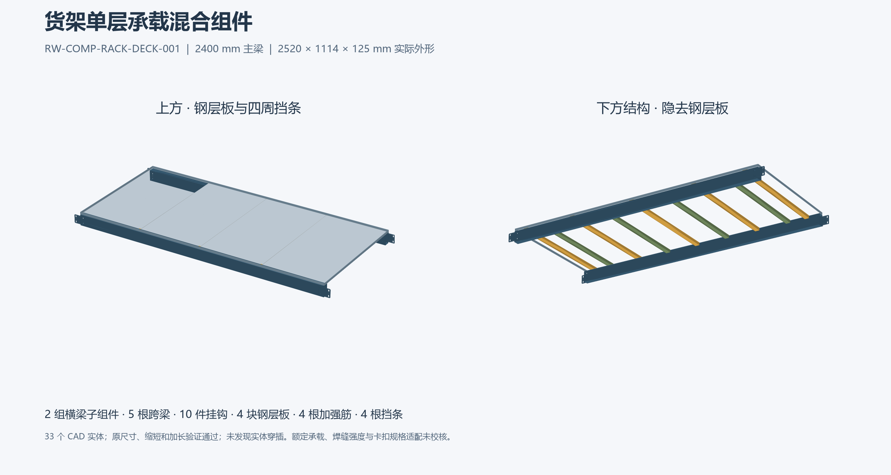

# 货架单层承载混合组件

组件编码：`RW-COMP-RACK-DECK-001`。共享草稿：`31020233-96dd-4751-a012-7b5f9f642bbc`，修订 R4。

在组件平台打开：http://127.0.0.1:5180/?draft=31020233-96dd-4751-a012-7b5f9f642bbc&stage=parameters

## 组成和尺寸

| 部件 | 数量 | 说明 |
|---|---:|---|
| 横梁子组件 | 2 | 每组100×50×1.5矩管主梁2400 mm，双端连接板2件；固定发布子组件引用 |
| 承托跨梁 | 5 | 1000×40×25 mm，沿主梁长度5%、25%、50%、75%、95%布置 |
| 跨梁挂钩 | 10 | 配合50 mm梁宽，双侧总间隙1 mm，连接跨梁两端 |
| 钢层板 | 4 | 598×1100×2 mm，板间缝2 mm，外侧各留1 mm |
| 层板底部加强筋 | 4 | 1000×40×25 mm，每块层板中部1根 |
| 周边挡条 | 4 | 高20 mm、厚2 mm；侧条1100 mm，前后条2398 mm |
| 防抬五金套件 | 10 | 免打孔卡扣、M6压紧螺栓、螺母、垫圈，计入五金清单 |

顶层29个成员，横梁子组件展开后33个实体零件。主梁中心距1057 mm，矩管梁体外深1107 mm，挂钩外深1114 mm。包含端板外伸与挡条的总外形为2520×1114×125 mm。8个端板孔作为与外部柱片连接的预留接口。

钢层板、加强筋、跨梁、挂钩与挡条组成焊接托盘，坐落于双主梁，10套防抬卡扣限制抬起。主梁与端板沿用M8螺栓连接。几何关系包含实际接触、端部焊接定位、拼缝和宽度驱动参考；界面“0内部连接”指正式工程配合数量，实际几何联动关系保存在geometryDesign中。几何通过不等于工程配合或承载验收。

## 五金清单

36个已连接节点均已确认：18个配置五金，18个声明无需额外五金；共4类、7种、82件。

| 类别 | 名称 | 规格 | 数量 |
|---|---|---|---:|
| 螺栓 | 六角螺栓 | M8 × 30 mm | 8 |
| 螺母 | 六角螺母 | M8 | 8 |
| 垫圈 | 平垫圈 | M8 | 16 |
| 卡扣件 | 免打孔防抬压板卡扣 | 适用50 mm梁宽；M6压紧型 | 10 |
| 螺栓 | 卡扣压紧螺栓 | M6 × 20 mm | 10 |
| 螺母 | 六角防松螺母 | M6 | 10 |
| 垫圈 | 平垫圈 | M6 | 20 |

挂钩已作为成员建模，不在五金中重复计数；卡扣套件以清单表达。8个预留柱片安装孔尚未与柱片相连，其外部连接五金在后续整架装配中统计。

## 验证与使用范围

- 原尺寸2520×1114×125 mm：通过。
- X缩短至2280 mm（对应主梁2160 mm）：通过。
- X加长至2760 mm（对应主梁2640 mm）：通过。
- 深度、板厚、截面与挂钩规格固定；4块钢板宽度保持一致，跨梁位置按梁长比例联动。
- 原尺寸对可能重叠的实体进行精确CAD布尔交集检查：未发现体积穿插。
- 平台返回deliveryReady=true，基础数据、接口、五金及几何检查通过。
- 额定载重未填写，工程规则执行尚未实现；焊缝、卡扣适配、防脱能力及承载强度未校核。

测试点通过不保证范围内任意尺寸均可用，新尺寸仍需实际CAD预览。完整单元保存为草稿，来源钢板、扩充接口主梁及横梁子组件已有固定开发发布版本供引用。

## 文件

- `RW-COMP-RACK-DECK-001.component.json`：平台组件原始文档与嵌套子组件快照。
- `RW-COMP-RACK-DECK-001.step`：33个真实CAD实体的装配导出。
- `hardware.csv`：五金明细。
- `qualification.json`、`validation.json`、`cad-inspection.json`：验收和实体检查记录。
